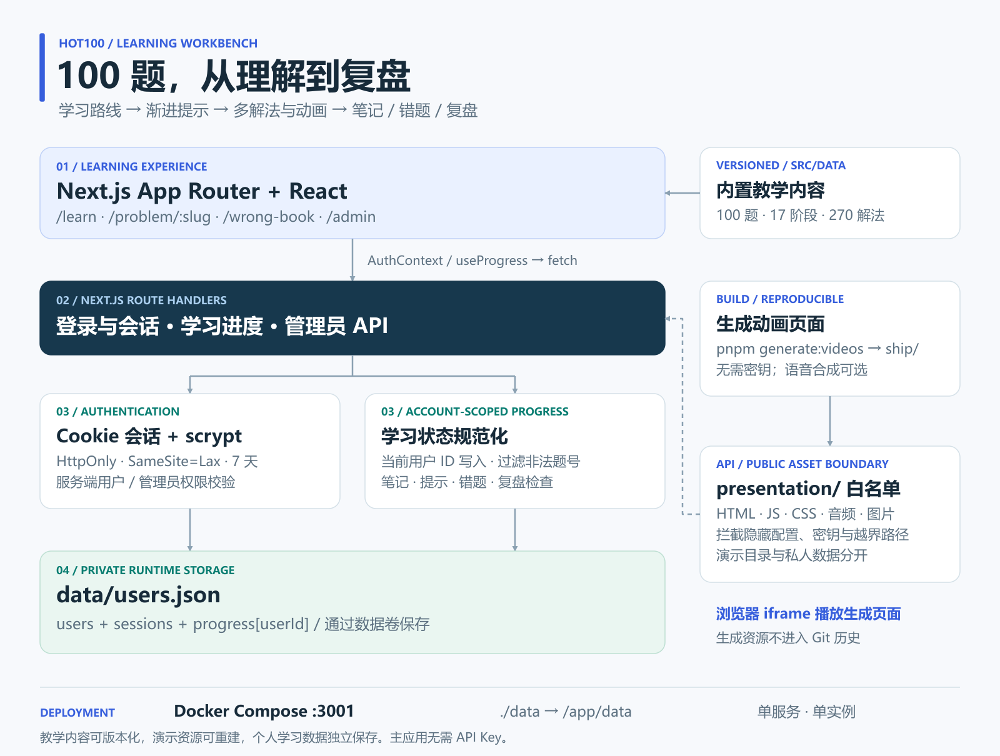

# Hot100 学习助手

围绕 LeetCode Hot100 组织的算法学习与复盘工具：按阶段选题，逐步阅读提示、解法和动画，再用完成标记、错题和笔记留下自己的理解。

它适合“看过答案却讲不清楚”和“做过但容易忘”的学习过程。项目提供教学内容与进度管理，**不执行用户代码，也不提供在线判题**；自己的实现仍需在本地或原题平台运行。

[运行项目](#运行项目) · [学完第一题](#学完第一题两数之和) · [账号与记录](#账号与记录) · [教学素材](#教学素材怎样生成) · [部署](#部署与备份)

## 运行项目

推荐 Node.js 22.22+，使用项目指定的 pnpm 10.17.1。首次运行会在本地生成教学动画资源，不需要模型或语音 Key：

```bash
git clone https://github.com/kayaduster607-jpg/letcode.git
cd letcode
corepack enable
corepack prepare pnpm@10.17.1 --activate
pnpm install --frozen-lockfile
pnpm generate:videos
pnpm dev
```

打开 [http://localhost:3001](http://localhost:3001)，使用普通演示账号 `user01`、密码 `user123456` 登录。

## 学完第一题：两数之和

1. 从学习路径或题目列表打开“两数之和”，先看题意和示例，暂不展开完整解法。
2. 在纸上或本地编辑器尝试 `nums = [2, 7, 11, 15]`、`target = 9`。这个输入的正确结果是索引 `[0, 1]`。
3. 遇到困难时逐步查看提示，再比较暴力枚举和哈希表思路。推进动画，观察每一步查什么、保存什么，尝试自己解释为什么不会重复使用同一元素。
4. 在本地或原题平台运行自己的代码。回到工具后，标记完成；仍有卡点就加入错题。
5. 写入笔记，例如“先查询 target - x，再把 x 的索引写入表”，保存后返回学习页，核对完成状态、笔记和错题入口。

| 你在工具中输入 | 页面输出 | 保存结果 |
| --- | --- | --- |
| 选择阶段、题目、提示或解法 | 题意、代码、解释和逐步演示 | 当前浏览位置 |
| 完成 / 错题标记 | 进度统计与错题集合 | 当前账号的学习状态 |
| 自己的错误原因和理解 | 可回看的题目笔记 | 服务端个人笔记 |

算法数组只是题目示例，不是网页的代码提交入口。成功完成一轮学习应当是：能讲清解法，自己的代码通过验证，保存后的状态在重新登录后仍可读取。

## 学习内容与路径

题目按 17 个阶段组织，共 100 题、270 种解法。可以顺序推进，也可以从题目列表、搜索或错题入口回到薄弱题目。渐进提示用于先给线索，动画用于展开状态变化，笔记用于保留当时为什么出错。



Next.js 同时提供页面、API 和资源入口。教学数据与账号记录分开：题目内容由源码维护，练习状态通过账号 API 保存。采用单个应用和 JSON 文件，部署较轻，但持久化没有数据库事务或跨进程写锁，适合受控单实例使用。

## 账号与记录

| 账号 | 初始密码 | 用途 |
| --- | --- | --- |
| `user01` 至 `user10` | `user123456` | 学习、错题和笔记 |
| `admin` | `admin@123` | 创建普通账号、查看数据、重置普通账号密码 |

以上均为源码中的公开演示凭据。对外部署前，应调整 `src/lib/seededAccounts.ts` 中的初始密码，使用新的空数据目录初始化；已经保存的账号不会因修改种子自动改密。管理页没有管理员自助改密入口，预置账号也不能从管理界面删除。

默认 `data/users.json` 保存账号、会话和按用户划分的进度。可用 `HOT100_DATA_DIR` 指定其他目录。它包含私人笔记和会话信息，备份时复制完整数据目录，避免提交到 Git。

会话 Cookie 为 HttpOnly、SameSite=Lax，有效 7 天。退出会移除当前会话；管理员重置普通账号密码不会自动撤销全部旧会话。公网部署需要 HTTPS 与相应安全 Cookie 配置。

## 教学素材怎样生成

```bash
pnpm generate:videos
node scripts/audit_hot100_video_pages.mjs ./ship
```

生成物位于 `ship/`，包括点击推进的演示页面、脚本和清单；路径可通过 `VIDEO_PRESENTATION_ROOT` 调整。这些资源不提交 Git，因此克隆后先生成，Docker 构建也会执行这一流程。

默认演示无需语音。可选 `scripts/synthesize_hot100_mimo.py` 从进程环境读取 `MIMO_API_KEY` 调用语音服务；如需使用，应先检查参数、输出和服务费用，主学习流程不依赖它。资源目录只放准备公开给浏览器的文件。

## 部署与备份

已有 Docker / Compose 时：

```bash
docker compose up -d --build
docker compose ps
docker compose logs --tail 100 hot100
```

访问地址仍为 3001，Compose 将 `./data` 挂载到 `/app/data`。更新镜像时保留这个目录，不要用开发机账号数据覆盖线上记录。

不用 Docker 的生产启动方式：

```bash
pnpm build
pnpm exec next start -p 3001
```

`dev` 固定为 3001，原始 `start` 未固定端口；生产使用上述显式参数可保持地址一致。备份前暂停写入，再复制整个 `data/`；恢复时使用同一数据目录。

## 常见问题与维护

| 问题 | 检查项 |
| --- | --- |
| 动画提示缺少资源 | 是否执行 generate:videos，资源根目录是否指向 ship |
| 修改种子密码后仍能用旧密码 | 已有 users.json 不会按种子重置 |
| 两台设备进度不同 | 是否访问同一个服务、登录同一个账号 |
| 代码答案正确却没有判题结果 | 项目没有代码评测入口，请在本地或原题平台验证 |

```bash
pnpm typecheck
pnpm qa:content
pnpm qa:video-assets
pnpm build
```

内容、教学资源与其他检查的说明见项目 `scripts/`。维护顺序应当是先确保题目和解法一致，再检查动画资源、账号保存与部署，避免只检查页面是否能打开。
