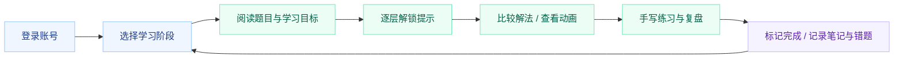
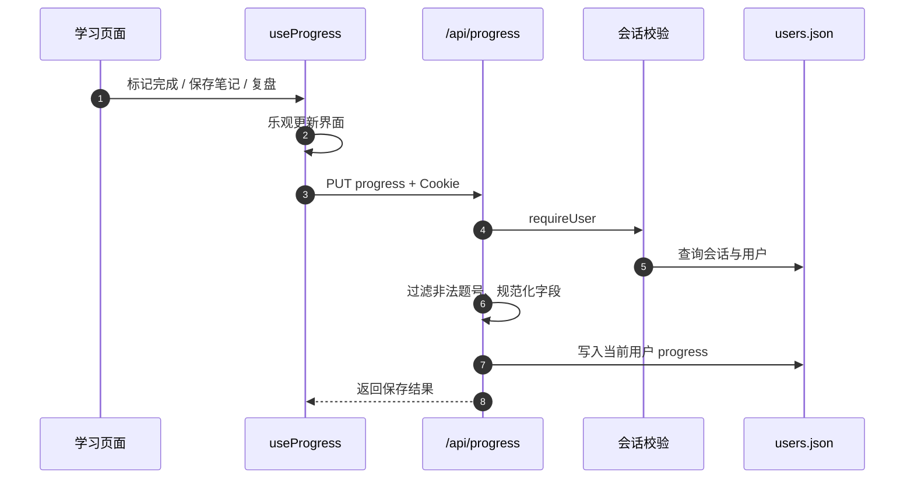

<div align="center">

# Hot100 学习助手

**沿着路线学，用提示推导，用错题和笔记复盘。**

100 道题 · 17 个学习阶段 · 270 种解法 · 账号独立学习进度


[项目亮点](#项目亮点) · [系统架构](#系统架构) · [快速开始](#快速开始) · [账号与数据](#账号与数据) · [Docker 部署](#docker-部署) · [验证记录](docs/validation.md)

</div>


Hot100 学习助手把 LeetCode Hot100 组织成一个可追踪、可复盘的学习工作台。学习者可以按阶段选题，逐层解锁提示，比较不同解法，查看样例动画，并把完成状态、错题原因、个人笔记和复盘检查保存到自己的账号。

项目面向个人算法训练、小组学习和小班教学，采用 **Next.js 全栈单体 + JSON 文件持久化**：页面、登录、管理员功能和进度 API 一起部署，无需外部数据库。主应用不需要 API Key；语音合成是独立的可选开发工具。

## 项目亮点

| 能力 | 实际实现 |
| --- | --- |
| 有顺序的学习路线 | 17 个阶段覆盖数组与哈希、双指针、链表、树、图、回溯、动态规划等主题，100 道题均进入路线 |
| 六层渐进提示 | 从读题与暴力思路，到瓶颈、模式识别、伪代码和参考代码，按需展开思路 |
| 多解法对比 | 100 道题对应 270 种解法，提供推荐标记、思路、复杂度说明及 Python 代码 |
| 逐题精修 | 100 份精修数据包含手写步骤、边界样例、常见坑和面试检查单 |
| 样例驱动动画 | 从内置数据生成 100 套点击推进的演示页面，由题目页 iframe 播放；可选接入预先合成的音频 |
| 个人学习闭环 | 记录完成情况、提示解锁、学习天数、笔记、错题原因、掌握状态和复盘检查 |
| 管理员工作台 | 查看账号进度与学习记录，新增普通账号、重置普通账号密码、删除自建普通账号 |
| 简化部署 | 一个 Next.js 服务，支持 standalone 镜像、Compose 数据卷及独立的公开动画目录 |

## 学习流程



主要页面：`/login` 登录，`/` 学习概览，`/learn` 路线与筛选，`/problem/:slug` 逐题学习，`/wrong-book` 错题复习，`/admin` 账号管理。

## 系统架构

上方架构图提供 [PNG](docs/assets/architecture.png)、[SVG 矢量原稿](docs/assets/architecture.svg) 和 [绘图脚本](docs/assets/generate_architecture.py)。

| 层级 | 技术与职责 |
| --- | --- |
| 页面与组件 | Next.js 16 App Router、React 19、TypeScript 6、Tailwind CSS 4；组织学习、笔记、错题和管理流程 |
| 客户端状态 | AuthContext、useProgress / useHints / useNotes；加载当前账号数据、乐观更新并同步 API |
| 认证与 API | Route Handlers 校验会话和管理员角色；页面 Proxy 提供登录跳转，业务权限仍在服务端校验 |
| 账号存储 | Node.js 文件读写；scrypt 随机盐密码哈希、7 天会话、按用户 ID 保存进度 |
| 教学内容 | `src/data/` 内置题目、路线、精修内容和多解法，随代码一起版本管理 |
| 动画资源 | 生成脚本输出 `ship/<slug>/presentation/`；API 仅服务该目录下允许的公开资源类型 |
| 部署 | Node.js 22、pnpm 10.17.1、standalone Docker 镜像及 Compose |

这套结构将教学内容与私人学习数据分开：题目和演示可以重建，账号、会话、笔记及错题记录保存在独立数据目录。服务端按当前会话的用户 ID 写入进度，不接受客户端指定其他账号作为保存目标。

### 进度同步的数据流



## 快速开始

推荐 **Node.js 22.22+**，包管理器版本按 `package.json` 使用 **pnpm 10.17.1**。Python 仅用于教学代码静态检查和可选语音工具。

```bash
git clone https://github.com/kayaduster607-jpg/letcode.git
cd letcode
corepack enable
corepack prepare pnpm@10.17.1 --activate
pnpm install --frozen-lockfile
pnpm generate:videos
pnpm dev
```

打开 [http://localhost:3001](http://localhost:3001)，使用下方预置演示账号登录。`generate:videos` 根据当前教学数据生成动画、脚本和清单，不调用语音服务，也不需要密钥。

生产运行：

```bash
pnpm build
pnpm exec next start -p 3001
```

`dev` 已固定使用 3001；原始 `start` 脚本为 `next start`，直接调用且未设置 `PORT` 时使用 Next.js 默认端口。需要保持 3001 时使用上方显式命令。

## 账号与数据

### 预置演示账号

| 用户名 | 初始密码 | 能力 |
| --- | --- | --- |
| `admin` | `admin@123` | 查看账号数据、创建普通账号、重置普通账号密码、删除自建账号 |
| `user01` 至 `user10` | `user123456` | 独立学习进度、笔记和错题记录 |

这些是源码中公开的演示密码。对外部署前，应先修改 `src/lib/seededAccounts.ts` 中的初始密码，再使用新的空数据目录初始化。已有账号的密码哈希不会因修改种子配置自动更新；当前管理页面只能重置普通账号密码，没有管理员自助改密入口。

系统禁止公开注册和重新初始化管理员；管理员可以创建额外普通账号。预置账号不能从管理界面删除，自建普通账号删除时会清理其进度和会话。

### 持久化位置

默认位置为 `data/users.json`，可通过 `HOT100_DATA_DIR` 指定另一个目录：

```text
data/users.json
├── users       # 账号、角色、随机盐密码哈希
├── sessions    # 会话 token、用户 ID、过期时间
└── progress    # 按用户 ID 分开的学习数据
```

会话使用 HttpOnly、SameSite=Lax Cookie，保存 7 天；退出会删除当前服务端会话。当前登录 Cookie 未设置 Secure，公网服务应结合 HTTPS 和安全 Cookie 策略配置。管理员重置普通账号密码时，现有会话不会自动全部撤销。

数据目录包含私人笔记和会话信息，已由 Git 与 Docker 构建上下文排除。当前 JSON 读写没有事务或跨进程写锁，并且读取会规范化后回写；适合受控单实例使用，不能按数据库的并发和容错能力理解。重要数据应定期备份。

## 动画与可选语音

```bash
# 生成 100 套点击推进的演示
pnpm generate:videos

# 检查生成页面和脚本
node scripts/audit_hot100_video_pages.mjs ./ship
```

默认动画根目录为当前项目的 `ship/`，也可以通过 `VIDEO_PRESENTATION_ROOT` 指向独立目录。生成资源不提交到 Git，Docker 构建时会自动生成；本地首次运行应先执行生成命令，否则动画接口返回缺少资源的提示。

`scripts/synthesize_hot100_mimo.py` 是可选 MiMo TTS 工具，密钥仅从进程环境变量 `MIMO_API_KEY` 获取，不自动读取任何 env 文件。本次发布没有执行语音合成，也未打包个人音频、语音样本或 TTS 日志。需要语音时，应自行配置服务凭据、检查脚本参数及生成结果；主应用可以使用无语音动画。

资源 API 只公开 `presentation/` 下允许的 HTML、CSS、JavaScript、音频、图片和 JSON；隐藏文件、密钥文件类型、敏感配置文件名、目录穿越和越界符号链接会被拦截。`ship/` 应只放准备公开的生成资源。

## Docker 部署

从克隆后的项目根目录运行：

```bash
docker compose up -d --build
docker compose ps
docker compose logs --tail 100 hot100
```

默认访问 [http://localhost:3001](http://localhost:3001)。构建过程安装锁定依赖、生成动画并构建 standalone 服务；容器入口调整数据目录权限后，以 `nextjs` 用户运行应用。

| 配置 | 默认值 / 含义 |
| --- | --- |
| 宿主机/容器端口 | `3001:3001` |
| 数据卷 | `./data:/app/data`，保存账号、会话和学习进度 |
| `VIDEO_PRESENTATION_ROOT` | Compose 中为 `/app/ship`，镜像构建时生成 |
| `HOT100_DATA_DIR` | 默认当前工作目录下 `data`；可为直接运行或测试指定隔离路径 |
| `NODE_ENV` | Compose 中为 `production` |

更新代码时保留宿主机 `data/`，不要用开发机上的账号文件覆盖线上文件。备份应在暂停写入后复制整个数据目录，例如 Linux/macOS：

```bash
docker compose stop
tar -czf hot100-data-backup.tar.gz data
docker compose start
```

备份包含私人数据，不应上传公开仓库。实际公网部署还需自行配置域名、HTTPS、网络访问限制和初始账号密码；本仓库只提供应用与单实例容器配置。

## 开发与验证

```bash
pnpm typecheck          # TypeScript
pnpm qa:content         # 题库、路线、精修及多解法完整性
pnpm qa:video-assets    # 公开资源路径边界
pnpm qa:python          # Python 教学代码的静态兼容性检查
pnpm audit --audit-level moderate
pnpm build
node scripts/verify_http.mjs
```

HTTP 验证自动使用临时账号数据目录，并在本机临时端口启动构建好的服务，不读取真实账号文件。运行前需完成 `pnpm generate:videos` 和 `pnpm build`。

本次验证通过：100 题 / 100 精修 / 270 种解法完整性、570 段 Python 片段检查、100 套动画静态检查、30 项资源边界检查、33 项 HTTP 检查和生产构建。最终锁文件审计返回 0 条已知漏洞告警；这不替代持续更新和应用安全测试。详见 [验证记录](docs/validation.md) 与 [密钥检查说明](docs/security-review.md)。

`lint` 脚本实际运行 `tsc --noEmit`，并非 ESLint。Python 兼容性检查基于 AST 和已列出的 API 规则，不等于所有解法已在 LeetCode 上执行通过。

## 项目结构

```text
letcode/
├── src/app/                 # 页面与 API Route Handlers
├── src/components/          # 提示、题解、动画、错题、笔记等组件
├── src/contexts/            # 登录状态
├── src/hooks/               # 当前账号学习状态与保存逻辑
├── src/data/                # 100 题、17 阶段、270 解法及精修
├── src/lib/                 # 会话、scrypt、存储、进度、公开资源策略
├── scripts/                 # 内容生成、静态 QA 与隔离验证
├── docs/assets/             # 架构图和生成脚本
├── public/                  # 应用静态文件
├── ship/                    # 生成的演示资源，Git 忽略
├── data/                    # 私人账号与学习数据，Git 忽略
├── Dockerfile
└── docker-compose.yml
```

## 范围与扩展

项目提供教学、阅读参考代码和手写练习流程，没有在线执行用户代码或提交判题的沙箱。当前部署面向单实例，后续可扩展数据库、写入事务、会话撤销、管理员改密、数据导出和持续集成。

部分历史素材处理脚本仍保留本机参考资料路径，使用前需检查参数；第三方 PDF、参考目录和个人生成素材未包含在公开仓库。题目保留原站链接，关联内容的权利归属以原作者声明为准。`package.json` 标记 ISC，但当前没有独立 `LICENSE` 文件，不据此为第三方内容额外授予许可。
